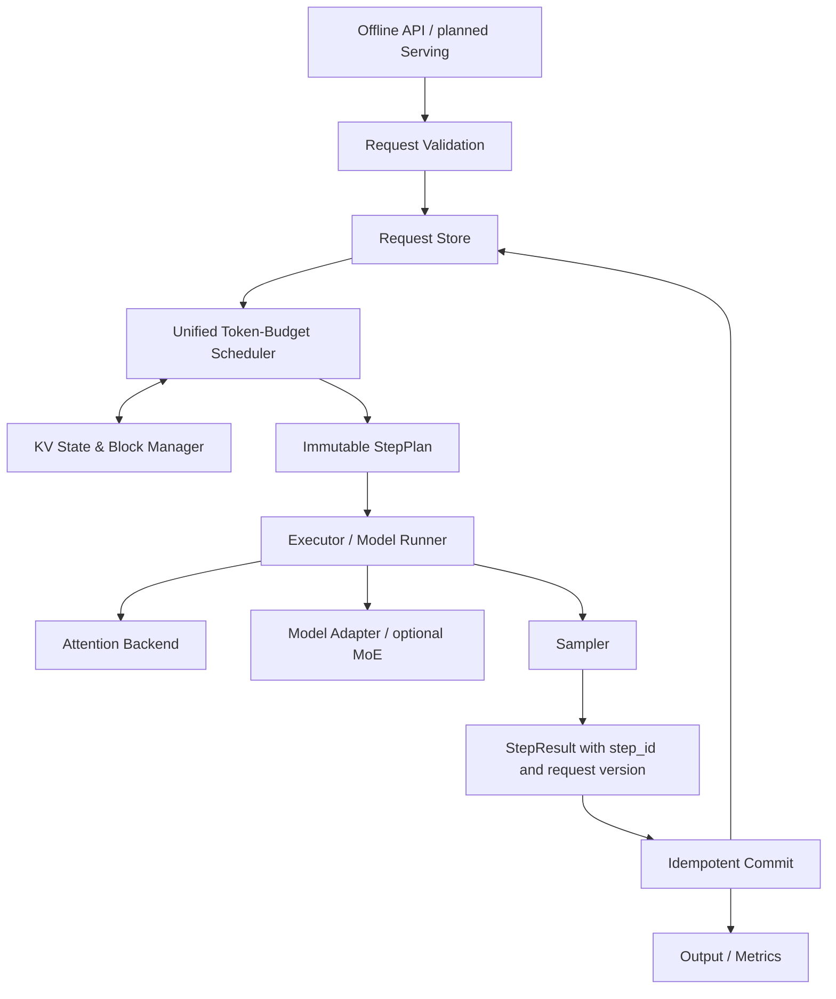

# Architecture & interface boundary (Stage 00)



**Data plane vs control plane:** The API never mutates KV ownership directly. Scheduler owns admissions and budget; CacheManager owns reservations; ModelRunner executes, returns immutable outputs; Commit applies results once and only once. The reference adapter is a correctness oracle, not a production optimization. Stage 00 defines contracts only; executable engine starts Stage 01.

| Component | Inputs | Outputs | Invariants |
| --- | --- | --- | --- |
| Request | unique ID, integer token IDs, sampling params | lifecycle state | no duplicate IDs; terminal state is monotonic |
| SequenceState | request ID, computed/committed lengths, cache handles | next execution cursor | `computed <= committed_prompt + committed_generation` unless speculative reservation explicitly tracked |
| Scheduler | waiting/running requests, available token blocks | immutable StepPlan | token budget not exceeded; no resource double-reservation |
| KV Manager | reservation(owner, step, generation), free list | owned block IDs | no negative refs; idempotent safe release; no sharing across incompatible config |
| ModelAdapter | tokens, positions, cache descriptors | logits / internal forward states | model weights/version and precision pinned |
| ModelRunner | StepPlan | StepResult | never commits globally visible output itself |
| Committer | StepResult + latest request version | state transition, output stream | (request_id, step_id) committed at most once; stale results rejected |

## Lifecycle and state machine

```text
WAITING -> RUNNING -> FINISHED
   |          |             ^
   +------> CANCELLED       |
   |          |             |
   +------> FAILED <---------+
```

Every terminal state is final. Cancellation of in-flight GPU execution defers resource reclamation until the worker signals completion or destruction is safe.

## Design for future stages

- v0.1 has one deterministic reference path and optional cache backend; no asynchronous storage mutation.
- v0.2 separates `plan`, `execute`, `commit`; uses request-version fencing and worker acknowledgements for async execution.
- v0.3 adds opt-in `ExpertBackend`, draft verification and SWA state restoration *only with model-compatible semantics*.
- v1.0 adds serving and optionally remote KV connectors; online-scale DeepSeek internal infra is out of scope.

See [RFC 0001](rfcs/0001-engine-core.md), [ADR 0001](adr/0001-scope.md), [ADR 0002](adr/0002-step-transaction.md).

